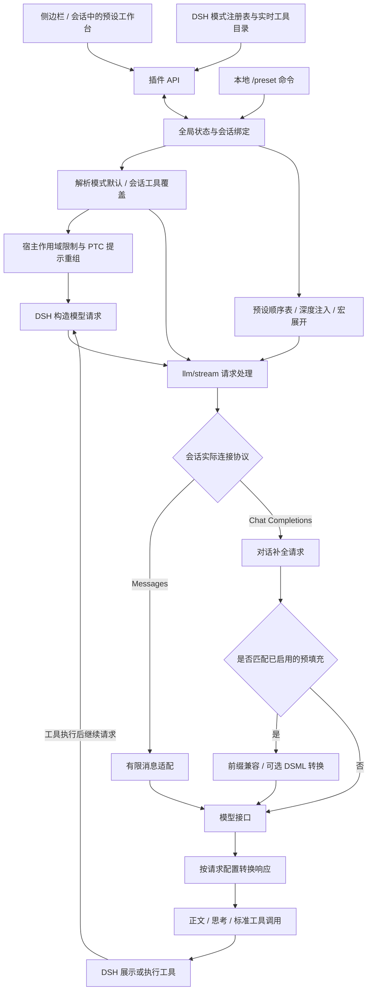

# 插件逻辑架构

插件分为工作台、状态与策略、请求处理三部分。预设注入和工具策略独立生效：关闭预设注入后，模式或会话的工具策略仍然有效。

工具执行守卫是独立的最后一道校验：即使历史中已有工具调用，或模型自行生成调用，也会检查当前工具策略。编辑器保留完整的工具目录，不会因某工具被关闭就让它从可编辑列表中消失。

### 代码对应关系

| 模块 | 职责 |
| --- | --- |
| 客户端入口及正则、Raw、折叠与滚动偏好源码 `src/client/`；其余工作台 `web/` | 侧边栏与会话入口，预设编辑、预览、工具管理和保存交互 |
| `src/index.mts`、`src/mode.mts` | 插件入口、API、命令、请求拦截、预设模式与生命周期管理 |
| `src/lib/store.mts`、`src/lib/preset-package.mts` | 状态持久化、版本校验、单文件导入导出 |
| `src/lib/dsh-system-template.mts`、`src/lib/request-settings.mts`、`src/lib/buffered-response.mts` | 模式系统模板、动态 DSH 宏、请求参数与非流式响应接入 |
| `src/lib/preset.mts`、`src/lib/macros.mts` | 顺序表、深度注入、变量宏、最终消息和预填充判定 |
| `src/lib/tool-presets.mts`、`src/lib/tool-restrictions.mts` | 工具策略、分组、会话作用域限制和 PTC 工具可见性 |
| `src/lib/connection.mts`、`src/lib/protocol.mts`、`src/lib/messages.mts` | 读取实际连接协议、记录协议观察结果、Messages 消息适配 |
| `src/lib/deepseek-beta.mts`、`src/lib/toolcall-prefill.mts`、`src/lib/output-extractor.mts` | 请求匹配、预填充兼容、DSML 转换和实验性正文提取 |

宿主侧以 `src/**/*.mts` 为源码，构建后生成发布包使用的 `index.mjs`、`mode.mjs` 和 `lib/*.mjs`；正文包的客户端、共享 Worker 和主包正则编辑模块使用 TypeScript，构建生成原路径下的 JavaScript；工作台其余客户端代码逐步迁移。包内文件入口见[包地图](../packages/README.md)。

### 工作台页面生命周期

`src/client/entry.ts` 将 iframe 保留在宿主 document.body，以插槽占位元素定位和裁剪。切换宿主页面只隐藏 iframe，返回时复用原文档；按会话及入口隔离，最多缓存四个闲置实例，插件生命周期结束时清理。宿主显式通知 iframe 的活动状态；隐藏缓存页暂停模板、正文包状态及请求预览订阅，返回时重连，避免长连接耗尽浏览器同源连接池。浏览器标签页隐藏和完整导航也释放订阅。宽度手柄隐藏规则依赖当前占位元素，离开预设页即恢复。

`disclosures.ts` 保存固定区域的折叠偏好；`scroll-state.ts` 为工作台完整导航和刷新保存滚动快照。进入 SPreset 时保留上次快照，避免导航按钮引起的临时滚动覆盖返回位置。这些界面状态不写入分享文件。

### 启动与运行时启停

初始化会读取状态并根据宿主的 `standard` 组成注册预设模式。状态损坏、模式组成缺失或目录不可写时，插件保留工作台并显示原因，停止注入和写入，不自动清空数据。修复后重新启用即可。

停用时停止接受新操作，等待在途写入和流式请求收尾，再释放请求桥接。插件不可用时，预设模式会明确拒绝使用。运行时启停与升级安装包是不同操作，安装或升级后仍按安装步骤重启宿主。

## 可选正文显示包

主包的 `display-config` 提供同登录边界的有效配置查询和保存后 SSE 更新，Store 仅在成功提交后通知；`display-regex` 与浏览器试运行复用无状态计算。`packages/display-regex` 独立注册客户端，读取 ChatSnapshot，匹配可见助手正文节点，在 Worker 中替换并借用宿主 MarkdownText 展示。显示根及订阅随生命周期释放，无法对应节点时回到宿主原文。主包依赖正文包，其 patch 在同一插件详情页注册两个运行条目，保留旧安装入口及数据。`packages/bundle` 保留为兼容入口。接口及边界见 [正文正则](api/DISPLAY_REGEX.md)。

正文包通过公开的 `presetDisplayRegex` 能力及 `preset-display/availability` 事件报告资源就绪和生命周期退出。主包读取当前能力、推送可用性，工作台和 SPreset 的有效正文开关由可用性与预设偏好共同决定。分包退出先撤回就绪状态，客户端卸载恢复原文并终止 Worker；暂时停用不写回预设偏好。
