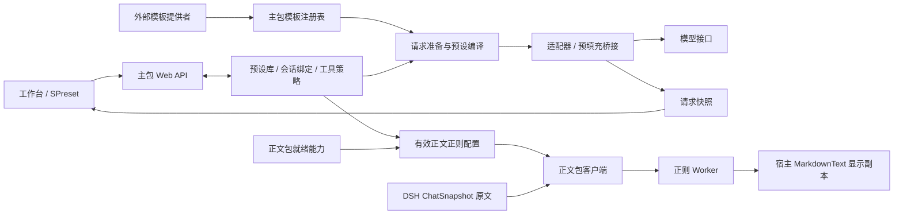

# 插件逻辑架构

本文对应进入 0.3.7 开发阶段的当前实现，新增 DSH 0.2.2 兼容。安装入口是 `dsh-preset-enhance`，主包精确依赖 `dsh-preset-display-regex`，由根目录 `cordis.patch.yml` 在同一插件页注册两个可分别启停的运行条目。`packages/bundle` 仅保留兼容入口，不是正常安装所需的第三个包。

## 包边界与数据流

主包负责配置与请求；正文包只替换展示，不写回会话、模型上下文或宿主导出。两包共用正则规则和计算模块，但发送提示词与显示正文分别从各自原文计算。模板提供者通过公开服务参与编译，不直接控制显示包。

## 请求处理

预设注入和工具策略独立生效：关闭预设注入后，模式或会话的工具策略仍然有效。

`src/lib/tool-restrictions.mts` 在 0.2.2 的 `tools.resolve` 前刷新 agent 工具限制，在不带 toolSet 的系统提示词组装前刷新旧版及预览范围。局部服务方法桥接保留 Cordis 调用方并随插件释放；模式工具通过 scope lease 识别。

工具执行守卫是独立的最后一道校验：即使历史中已有工具调用，或模型自行生成调用，也会检查当前工具策略。编辑器保留完整的工具目录，不会因某工具被关闭就让它从可编辑列表中消失。

实验性 SPreset 工具在同一准入准备阶段按 agent 注册，通过官方工具管线执行；调用消费在 `llm/stream` 中处理统一事件并生成宿主持久化的正文。脚本使用受限 QuickJS，详见 [SPreset 工具](api/SPRESET_TOOLS.md)。

### 动态解析、编译与预览

`src/index.mts` 的 `injectStream` 读取实际会话、模式、连接和绑定；无会话、专用 purpose 请求及已路由请求不重复注入。启用预设时，优先取得宿主本轮最终组装的 DSH 系统模板，再解析外部动态模板并进入 Store 事务编译。异步解析不占用状态写队列；提交前核对预设、变量及相关会话依赖，期间发生变化则拒绝使用过期结果。

编译负责模板关联、marker、chatHistory 深度修改、宏、提示词正则和末条预填充。缓存键包含预设、消息、协议、模板引用、动态正文和本次 DSH 系统模板，命中时复用结果，避免重复提交宏变量变更。模式系统模板按预设、模式和段落保存局部覆盖，其他段落跟随宿主默认；旧整篇模板优先使用，恢复默认不会修改其他模式。

`src/lib/dsh-assembly.mts` 在已有准备桥接返回后记录最终 assembly，通过 Agent、turn/step 和请求信号关联，核对原系统正文与 schemas 后复用。预览带独立标记，不能覆盖本轮；step/turn 结束、模式切换及停用时清理。它不保留 toolSet 的所有权，也不重新执行 tools.resolve。无关联的手工/旧式调用保留独立组装路径，模型选择读取 live Agent 与公开 projection snapshot，并显式传入 modelSelection。

草稿预览复用动态解析与编译，但不提交变量写入，也不发送模型请求。实际发送另建请求快照，经过适配器和 HTTP 桥接后捕获真正出站的请求体；两次准备之间输入或外部数据变化时，草稿与实际请求可能不同。消息卡片与 Raw 都读取同一快照，折叠和切换视图不会触发重新解析。

### 代码对应关系

| 模块 | 职责 |
| --- | --- |
| 客户端入口及正则、Raw、折叠与滚动偏好源码 `src/client/`；其余工作台 `web/` | 侧边栏与会话入口，预设编辑、预览、工具管理和保存交互 |
| `src/index.mts`、`src/mode.mts` | 插件入口、API、命令、请求拦截、预设模式与生命周期管理 |
| `src/lib/store.mts`、`src/lib/preset-package.mts` | 状态持久化、版本校验、单文件导入导出 |
| `src/lib/dsh-system-template.mts`、`src/lib/request-settings.mts`、`src/lib/buffered-response.mts` | 模式系统模板与动态 DSH 宏、请求参数与非流式响应接入 |
| `src/lib/dsh-assembly.mts`、`src/lib/dsh-template-source.mts`、`src/client/dsh-template-editor.ts` | 本轮组装关联、共享段落选择、分段编辑和只读上下文预览 |
| `src/lib/preset.mts`、`src/lib/macros.mts` | 顺序表、深度注入、变量宏、最终消息和预填充判定 |
| `src/lib/spreset-tools.mts`、`src/lib/spreset-script.mts`、`src/client/spreset-tools.ts` | 实验性工具注册、输出调用消费、受限脚本执行与编辑界面 |
| `src/lib/tool-presets.mts`、`src/lib/tool-restrictions.mts` | 工具策略、分组、会话作用域限制和 PTC 工具可见性 |
| `src/lib/connection.mts`、`src/lib/protocol.mts`、`src/lib/messages.mts` | 读取实际连接协议、记录协议观察结果、Messages 消息适配 |
| `src/lib/deepseek-beta.mts`、`src/lib/toolcall-prefill.mts`、`src/lib/output-extractor.mts` | 请求匹配、预填充兼容、DSML 转换和实验性正文提取 |
| `src/templates.mts`、`src/template-api.d.mts`、`src/lib/template-registry.mts`、`src/lib/template-bindings.mts`、`src/lib/dynamic-templates.mts` | 外部模板公开入口、注册、关联和动态解析；契约见[模板 API](api/TEMPLATE_API.md) |
| `src/lib/request-preview.mts`、`src/client/request-preview.ts`、`src/client/request-events.ts` | 请求快照、Raw JSON 树和活动页订阅；来源区别见[请求预览](guides/REQUEST_PREVIEW.md) |
| `src/lib/preset-reader.mts` | 内部 agent 的预设查询、字段裁剪与权限边界；见[只读 API](api/PRESET_READ_API.md) |
| `src/lib/prompt-regex.mts`、`src/lib/display-regex.mts`、`src/lib/display-config.mts`、`src/client/regex-editor.ts` | 提示词/显示两通道的规则、配置与共享编辑器；见[正文正则](api/DISPLAY_REGEX.md) |

宿主侧以 `src/**/*.mts` 为源码，构建后生成发布包使用的 `index.mjs`、`mode.mjs` 和 `lib/*.mjs`；正文包的客户端、共享 Worker 和主包正则编辑模块使用 TypeScript，构建生成原路径下的 JavaScript；工作台其余客户端代码逐步迁移。包内文件入口见[包地图](../packages/README.md)。

### 预填充与实际请求

预填充目标保存在预设的 `dsh_prefill_target`，默认 `reasoning`，可切换为 `content`；接口兼容开关仍是全局设置。`src/index.mts` 按本次会话和最终前缀激活桥接，`src/lib/deepseek-beta.mts` 将宿主传入的 `Request` 或支持的请求体形态读取为可检查的内容，再进行协议观察、前缀改写和实际请求捕获。宿主请求检查插件先包装为 `Request` 时仍走这条路径，不能只检查 `fetch(url, init)`。

实际 Raw 记录改写后的出站内容；没有捕获到 HTTP 请求时保留“适配器输入”标记。配置和协议边界见[预填充指南](guides/WORKBENCH.md#预填充与工具调用兼容)，字段见[分享格式](../PRESET_FORMAT.md)，验证证据见[工作台与预填充验证](testing/2026-10-16-WORKBENCH_PREFIX.md)。

## 状态归属

| 数据 | 归属与保存边界 |
| --- | --- |
| 预设库、当前默认、会话绑定、宏变量与编译结果、全局预填充设置、工具策略 | `PresetStore` 管理的 `DSH_HOME/preset-enhance/state.json`；写入经事务串行处理 |
| 系统模板、请求参数、预填充目标、正则规则与两通道偏好、模板引用 | 当前预设内部；按分享格式导出 |
| Chat 适配器模型列表与插件启停 | DSH 配置；不随预设分享 |
| 模板提供者注册、正文包能力、实际请求快照 | 运行时状态；随提供者或宿主生命周期更新，不是分享数据 |
| 折叠、滚动、自动保存偏好及待确认工具草稿 | 浏览器状态；不写进分享文件 |

分享包可恢复其中的全局预填充配置，工具配置仍需单独应用；不是完整状态文件备份。字段及导入规则以[单文件格式](../PRESET_FORMAT.md)为准。

## 生命周期与接入边界

### 工作台页面生命周期

`src/client/entry.ts` 将 iframe 保留在宿主 document.body，以插槽占位元素定位和裁剪。切换宿主页面只隐藏 iframe，返回时复用原文档；按会话及入口隔离，最多缓存四个闲置实例，插件生命周期结束时清理。宿主显式通知 iframe 的活动状态；隐藏缓存页暂停模板、正文包状态及请求预览订阅，返回时重连，避免长连接耗尽浏览器同源连接池。浏览器标签页隐藏和完整导航也释放订阅。宽度手柄隐藏规则依赖当前占位元素，离开预设页即恢复。

`disclosures.ts` 保存固定区域的折叠偏好；`scroll-state.ts` 为工作台完整导航和刷新保存滚动快照。进入 SPreset 时保留上次快照，避免导航按钮引起的临时滚动覆盖返回位置。这些界面状态不写入分享文件。

工作台入口以受保护的动态 import 加载分段编辑模块。该模块或其依赖加载失败时，只禁用 DSH 模板编辑并提示重启，主配置加载仍继续；这不代表所有资源缺失都能恢复。CLI 更新磁盘快照后，旧进程可能仍缺少新增资源路由，必须确认插件重新加载或重启宿主。

### 启动与运行时启停

初始化会读取状态并根据宿主的 `standard` 组成注册预设模式。状态损坏、模式组成缺失或目录不可写时，插件保留工作台并显示原因，停止注入和写入，不自动清空数据。修复后重新启用即可。

停用时停止接受新操作，等待在途写入和流式请求收尾，再释放请求桥接。插件不可用时，预设模式会明确拒绝使用。运行时启停与升级安装包是不同操作，安装或升级后仍按安装步骤重启宿主。

### 外部模板与只读查询

外部插件通过 `presetTemplates` 注册普通模板、动态模板及 marker 关联。主包跟踪提供者的启停和热重载，失效引用保留用于恢复；冲突及固定版本由工作台处理。当前支持模板和 chatHistory 的约定扩展，通用提示词序列处理链、通用脚本运行时、MVU 和组件状态服务仍属规划；已实现的受限 SPreset 工具脚本不提供这些接口，不能按方案接口直接调用。

工作台编辑 API 与显示配置 API 使用 DSH Web 登录边界。内部 agent 的只读查询由 `src/lib/preset-reader.mts` 发放绑定 agent 的短期凭证，不沿用浏览器登录作为外部公开授权；当前不提供外部匿名读取。公开契约见[模板 API](api/TEMPLATE_API.md)和[只读 API](api/PRESET_READ_API.md)。

## 可选正文显示包

主包的 `display-config` 提供同登录边界的有效配置查询和保存后 SSE 更新，Store 仅在成功提交后通知；`display-regex` 与浏览器试运行复用无状态计算。`packages/display-regex` 独立注册客户端，读取 ChatSnapshot，匹配可见助手正文节点，在 Worker 中替换并借用宿主 MarkdownText 展示。显示根及订阅随生命周期释放，无法对应节点时回到宿主原文。主包依赖正文包，其 patch 在同一插件详情页注册两个运行条目，保留旧安装入口及数据。`packages/bundle` 保留为兼容入口。接口及边界见 [正文正则](api/DISPLAY_REGEX.md)。

正文包通过公开的 `presetDisplayRegex` 能力及 `preset-display/availability` 事件报告资源就绪和生命周期退出。主包读取当前能力、推送可用性，工作台和 SPreset 的有效正文开关由可用性与预设偏好共同决定。分包退出先撤回就绪状态，客户端卸载恢复原文并终止 Worker；暂时停用不写回预设偏好。

正文客户端使用 ChatSnapshot 原始 Markdown，在可终止 Worker 中执行替换，再借用宿主 MarkdownText 渲染。只处理能对应的助手 text block，推理、工具和图片块不接管；流式按新原文重新计算，不把上次替换结果当作输入。匹配失败、计算超时或配置失效时恢复宿主原文。

显示容器保留原正文样式类与层级以兼容皮肤。GenUI 围栏仍交给宿主 Markdown 和另装 GenUI 处理，正文包不实现组件执行器；改变围栏结构及宿主私有文件渲染上下文的兼容限制见[正文正则](api/DISPLAY_REGEX.md#渲染与边界)。

## 维护入口

源码与生成物分工见[包地图](../packages/README.md)，命令与 locale 范围见[开发验证](DEVELOPMENT.md)。用户操作以 `guides/`、接入契约以 `api/` 为准；[任务索引](plans/PACKAGE_IMPLEMENTATION_TASKS.md)区分未落地能力，测试记录保留其具体版本和证据边界。
